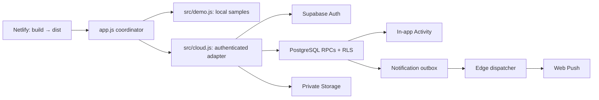

# AziCe? — small daily updates, shared with friends

**BETA v0.1.1.1 — prepared locally** · [Live beta](https://azice.aagameri.tech) ·
[Architecture](docs/ARCHITECTURE.md) · [Documentation](docs/README.md) ·
[Contributing](CONTRIBUTING.md) · [Security](SECURITY.md)

AziCe? is a mobile-first, friends-only progressive web app for adults. Share an
“I Drank” or “I Didn't Drink” check-in, a reason and camera photos when required by
the post type. It explores private social sharing without streaks, rankings or
pressure to consume alcohol.

The deployed link is the real beta service, **not a testing sandbox**. Use the
local demo below to inspect the app without production accounts or backend access.
Application source code and documentation are [MIT-licensed](LICENSE). The official
name, logo, mascot and brand identity are reserved; see [BRANDING.md](BRANDING.md).
Publication still requires owner approval; the current repository remains private.

## A look inside

| Feed | Friends & Invites | Profile and calendar |
| --- | --- | --- |
|  |  |  |

Real browser captures of the **local synthetic demo**, at a 390×844 emulated
viewport, captured from the preceding **BETA v0.1.1.0**. No real accounts, user photos or personal invitation links were used.
The pictured invite is an inert loopback/demo example. See
[capture provenance and artwork-review limits](docs/screenshots/README.md).

## Features

- Friends-only Feed with a 48-hour interaction window, reactions and comments.
- Personal invitation links, exact-username requests and limited discovery through
  comments the requester may already view; no public profile directory.
- Private Profile/calendar, editable identity and gallery-selected avatars.
- Camera-only post photos (up to three), proportional JPEG optimization, stable
  4:5 previews/carousels and an uncropped viewer.
- Three published posts per configured local day, enforced server-side.
- Incoming-request indicators and Activity for comments/reactions on your posts.
- Optional Web Push, device/category preferences and installed-PWA invitations;
  posting reminders are optional and off by default.
- Email/password and Google Auth, onboarding and isolated password recovery.
- Mobile safe areas, accessible dialogs and an existing dark/orange design.

The backend-free demo implements local sample interactions, not real Auth, friend
delivery or Web Push. Production capabilities require their configured backend
and browser/device support; see [verification limits](docs/testing/verification-limits.md).

## Stack and architecture

Vanilla JavaScript modules, HTML and CSS; no frontend framework or bundler.
Supabase provides Auth, PostgreSQL RPC/RLS, private Storage and Edge Functions.
A service worker supports the PWA shell and push. Netlify packages and publishes
the static app. npm dependencies are development/test tools only.

| Local source | Responsibility |
| --- | --- |
| [app.js](app.js) | UI coordinator: state, routing, events, dialogs and asynchronous guards |
| [src/cloud.js](src/cloud.js), [src/demo.js](src/demo.js) | Caller-owned cloud clients or local synthetic data |
| [src/presentation.js](src/presentation.js) | Stateless escaping, formatting and markup |
| [src/auth-helpers.js](src/auth-helpers.js) | Session classification and injected recovery storage |
| [src/image-processing.js](src/image-processing.js) | Browser-realm canvas encoding and decoding |
| [cloud.js](cloud.js), [demo.js](demo.js) | Compatibility exports preserving root module URLs |
| [styles.css](styles.css) | One ordered stylesheet; no preprocessor or cascade reordering |



Engineering notes cover [upload recovery](docs/backend/post-upload-recovery.md),
[account/request isolation](docs/archive/beta-v0.1.1.0-stabilization.md),
[Web Push](docs/backend/web-push.md), and [migration status](docs/backend/migration-status.md).
Read [ARCHITECTURE.md](docs/ARCHITECTURE.md) for module ownership, trust boundaries,
notification flow and caching. The [documentation index](docs/README.md) separates
current instructions from technical evidence and historical release records.

## Run the safe local demo

Use **Node.js 24** and npm:

```sh
npm ci --ignore-scripts
npm run dev
```

Open **http://localhost:5173**. Fresh clones use the existing labeled local demo,
with synthetic posts/friends and no Supabase connection or API keys. Demo invitation
links are examples. Camera access still needs a camera and localhost/HTTPS.

For your own disposable backend, copy config.example.json to ignored
**config.local.json** and supply only that project's public configuration.
The local server validates it and rejects the production project.
See [CONTRIBUTING.md](CONTRIBUTING.md); never use privileged keys or real users.
Do not expose the source server to the internet.

## Checks

```sh
npm test
npm run check
npm run test:sql
npm run build
node scripts/check-demo-build.mjs
node scripts/check-doc-links.mjs
git diff --check
```

| Command | What it verifies |
| --- | --- |
| npm test | UI/adapters, account races, comments, media, native ESM identity/startup, packaging/MIME, worker models and ordered CSS contracts using synthetic responses. |
| npm run check | JavaScript syntax, all three Edge syntax transpilation checks and public-config validation, offline. |
| npm run test:sql | PGlite SQL/RLS regressions in disposable in-memory databases; no hosted backend. |
| npm run build | Public-only **demo** output in dist/. |

Four optional SDK smoke tests skip unless their hash-verified local artifact is
provided; [instructions](docs/backend/sdk-versions.md). Default branding tests use the
committed approved-master fingerprint. Original-source comparison is explicit
authoring verification through AZICE_BRANDING_SOURCE, not a required untracked file.
Native PostgreSQL and real-device/service tests are separate; mocks or PGlite do
not prove hosted Auth, physical Storage cleanup or real push delivery.

## Production and previews

PR #1 is merged; production main is `34b4766124d94aece509b444a61fd6cc157a465d`.
GitHub CI passed and Netlify published that commit. Current evidence and the
owner-reviewed deployment settings are in [DEPLOY.md](DEPLOY.md).

The recorded hosted verification is dated **2026-10-28**. The module/CSS/docs
refactor on `refactor/project-structure` is still **local and uncommitted**, with
APP_VERSION intentionally prepared as **0.1.1.1**; production remains BETA v0.1.1.0. Local test results are not a new GitHub CI run or deployment.

The unchanged Netlify command is **node scripts/build.mjs**, publishing **dist**.
Its production context generates dist/config.js from **config.production.json**,
which retains the exact existing public URL/key/VAPID values. No hosted settings,
secrets or backend behavior change is required. The profile is intentionally
public data; separating it prevents accidental use, not endpoint discovery.

Source config, default local builds, branch deploys and PR previews are demo-only.
**npm run build:production** is an explicit maintainer packaging check and does
not deploy anything, but its output connects to production if opened.
Generated dist/, local overrides, tools, SQL and operational files are not published
by the frontend allowlist. PWA identity remains unchanged; the only runtime presentation change is the release badge.

## Known limits and publication decisions

R03 account-deletion/upload concurrency remains unresolved and accepted for this
beta. Physical Storage leakage has **not** been confirmed. No complete-erasure
guarantee is made and no production reproduction is authorized.
Native Deno and real Storage failure recovery also remain incompletely verified.

The synthetic **390×320 Activity fixture** cannot scroll its last row fully clear
of navigation. This pre-existing result was identical before/after CSS formatting;
it is not a newly verified production/device failure. Physical iPhone/Android,
actual keyboard/notch behavior and authenticated offline use remain separate
acceptance checks. See [verification limits](docs/testing/verification-limits.md).

[docs/open-source-readiness.md](docs/open-source-readiness.md) records the proposed branch protection, CI and
preview restrictions, historical identity/privacy review, R03 disclosure decision,
and outstanding publication approvals. MIT covers the application code, not bundled
artwork or official branding. The mascot's ChatGPT origin is owner-confirmed;
legacy/demo artwork rights still need confirmation. Package publishing remains
private; see [BRANDING.md](BRANDING.md) before distributing a fork.
No access to production services is granted by the source-code license.

For security reports read [SECURITY.md](SECURITY.md). The existing
[Safety & Privacy contact](mailto:aagameriaa@gmail.com) is separate from Auth
email/SMTP configuration.
