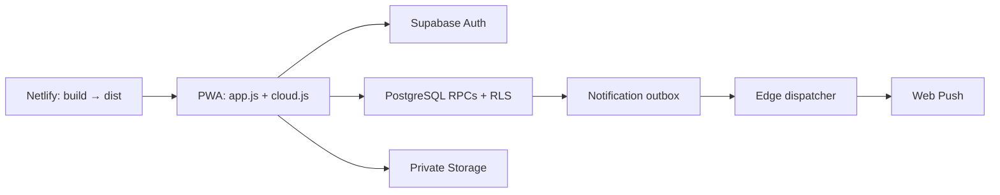

# AziCe? — a mobile-first, friends-only PWA

**BETA v0.1.1.0** · [Live beta](https://azice.aagameri.tech) ·
[Contributing](CONTRIBUTING.md) · [Security](SECURITY.md)

AziCe? lets adults share small daily updates with friends: “I Drank” or
“I Didn't Drink,” a reason and optional camera photos. It explores private social
sharing without streaks, rankings or pressure to consume alcohol.

The deployed link is the real beta service, **not a testing sandbox**. Use the
local demo below to inspect the app without production accounts or backend access.
Application source code and documentation are [MIT-licensed](LICENSE). The official
name, logo, mascot and brand identity are reserved; see [BRANDING.md](BRANDING.md).
Repository visibility still requires owner approval.

## Features

- Friends-only Feed with a 48-hour interaction window, reactions and comments.
- Personal invitation links, exact-username requests and limited discovery through
  comments the requester may already view; no public profile directory.
- Private Profile/calendar, editable identity and gallery-selected avatars.
- Camera-only post photos (up to three), proportional JPEG optimization, stable
  4:5 previews/carousels and an uncropped viewer.
- Three published posts per configured local day, enforced server-side.
- Incoming-request indicators and Activity for comments/reactions on your posts.
- Optional Web Push, device/category preferences and installed-PWA invitations.
- Email/password and Google Auth, onboarding and isolated password recovery.
- Mobile safe areas, accessible dialogs and an existing dark/orange design.

## Stack and architecture

Vanilla JavaScript modules, HTML and CSS; no frontend framework or bundler.
Supabase provides Auth, PostgreSQL RPC/RLS, private Storage and Edge Functions.
A service worker supports the PWA shell and push. Netlify packages and publishes
the static app. npm dependencies are development/test tools only.



Engineering notes cover [upload recovery](supabase/POST_UPLOAD_RECOVERY.md),
[account/request isolation](STABILIZATION_RELEASE.md),
[Web Push](supabase/WEB_PUSH.md), and [migration status](supabase/MIGRATION_STATUS.md).
The source is intentionally small; no restructuring is needed to contribute.

## Run the safe local demo

Use **Node.js 24** and npm:

```sh
npm ci --ignore-scripts
npm run dev
```

Open **http://localhost:5173**. Fresh clones use the existing labeled local demo,
with synthetic posts/friends and no Supabase connection or API keys. Demo invitation
links are examples. Camera access still needs a camera and localhost/HTTPS.

For your own disposable backend, copy config.example.json to ignored
**config.local.json** and supply only that project's public configuration.
The local server validates it and rejects the production project.
See [CONTRIBUTING.md](CONTRIBUTING.md); never use privileged keys or real users.
Do not expose the source server to the internet.

## Checks

```sh
npm test
npm run check
npm run test:sql
npm run build
```

| Command | What it verifies |
| --- | --- |
| npm test | UI/adapters, account races, comments, authorization contracts, media/branding and config/build behavior using synthetic responses. |
| npm run check | JavaScript syntax, all three Edge syntax transpilation checks and public-config validation, offline. |
| npm run test:sql | PGlite SQL/RLS regressions in disposable in-memory databases; no hosted backend. |
| npm run build | Public-only **demo** output in dist/. |

Four optional SDK smoke tests skip unless their hash-verified local artifact is
provided; [instructions](supabase/SDK_VERSIONS.md). Default branding tests use the
committed approved-master fingerprint. Original-source comparison is explicit
authoring verification through AZICE_BRANDING_SOURCE, not a required untracked file.
Native PostgreSQL and real-device/service tests are separate; mocks or PGlite do
not prove hosted Auth, physical Storage cleanup or real push delivery.

## Production and previews

The unchanged Netlify command is **node scripts/build.mjs**, publishing **dist**.
Its production context generates dist/config.js from **config.production.json**,
which retains the exact existing public URL/key/VAPID values. No hosted settings,
secrets or backend behavior change is required. The profile is intentionally
public data; separating it prevents accidental use, not endpoint discovery.

Source config, default local builds, branch deploys and PR previews are demo-only.
**npm run build:production** is an explicit maintainer packaging check and does
not deploy anything, but its output connects to production if opened.
Generated dist/, local overrides, tools, SQL and operational files are not published
by the frontend allowlist. APP_VERSION and PWA identity remain unchanged.

## Known limits and publication decisions

R03 account-deletion/upload concurrency remains unresolved and accepted for this
beta. Physical Storage leakage has **not** been confirmed. No complete-erasure
guarantee is made and no production reproduction is authorized.
Native Deno and real Storage failure recovery also remain incompletely verified.

[OPEN_SOURCE.md](OPEN_SOURCE.md) records the proposed branch protection, CI and
preview restrictions, historical identity/privacy review, R03 disclosure decision,
and outstanding publication approvals. MIT covers the application code, not bundled
artwork or official branding. The mascot's ChatGPT origin is owner-confirmed;
legacy/demo artwork rights still need confirmation. Package publishing remains
private; see [BRANDING.md](BRANDING.md) before distributing a fork.
No access to production services is granted by the source-code license.

For security reports read [SECURITY.md](SECURITY.md). The existing
[Safety & Privacy contact](mailto:aagameriaa@gmail.com) is separate from Auth
email/SMTP configuration.
