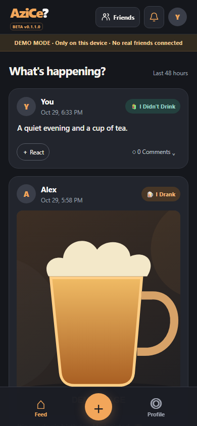
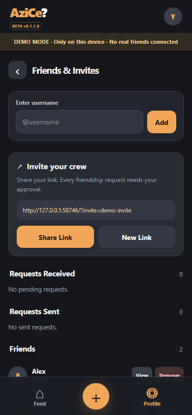
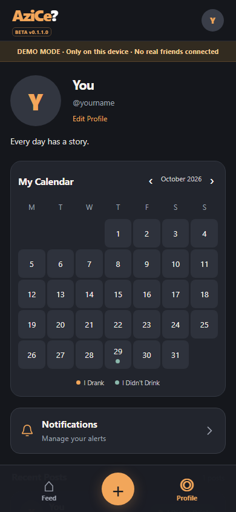

# AziCe?

*Every day has a story. Share yours with friends.*

**[Live App: https://azice.aagameri.tech](https://azice.aagameri.tech)**

AziCe? is a private, friends-only, mobile-first social PWA for adults. It combines
real authentication, daily posts and photos, reactions, comments, profiles and a
personal calendar. Check-ins support both “I Drank” and “I Didn't Drink,” without
streaks, rankings or pressure to consume alcohol.

Production runs **BETA v0.1.1.2** at `9a5575527`, including the A01–A04 stabilization fixes. [Deployment status](DEPLOY.md).

The live application uses production services. For development and evaluation,
use the isolated local demo below; it uses synthetic data and no production account.

## Screenshots

| Feed | Friends & Invites | Profile and calendar |
| --- | --- | --- |
|  |  |  |

These are real browser captures of the preceding **BETA v0.1.1.0** local demo at
390×844, not physical-device screenshots. They contain no real accounts, personal
photos or production invitation links. The Feed illustration is retained under the reserved-artwork policy; its project
origin is maintainer-attested rather than independently verified. [Capture provenance and artwork status](docs/screenshots/README.md).

## Features

- Friends-only Feed with a 48-hour interaction window and read-only history.
- Invitation links, exact-username requests and limited discovery through comments
  on posts the requester can already view; no public profile directory.
- Immutable comments, reactions and an Activity list for interactions on your posts.
- Three posts per configured local day, enforced in PostgreSQL.
- Camera-only post photos, up to three per post; proportional JPEG optimization,
  4:5 previews/carousels and an uncropped full-photo viewer.
- Editable profiles, gallery-selected avatars and a personal calendar.
- Email/password and Google authentication, onboarding and isolated password recovery.
- Optional Web Push with category/device preferences; posting reminders are off by default.
- Home Screen installation support, responsive layouts and mobile safe-area handling.

The local demo implements sample interactions, not real authentication, friend
request delivery or Web Push. Those features require a configured backend and
supported browser/device.

## Architecture and stack

Vanilla JavaScript, native ES modules, HTML and CSS; no frontend framework or bundler.
Supabase provides Auth, PostgreSQL RPCs/RLS, private Storage and Edge Functions.
Netlify builds the static frontend into `dist/`; service workers provide the public
PWA shell and notification handling. npm dependencies are development/test tools.

| Component | Responsibility |
| --- | --- |
| [app.js](app.js) | State, navigation, rendering, browser events and asynchronous UI guards |
| [src/cloud.js](src/cloud.js) / [src/demo.js](src/demo.js) | Authenticated backend adapter / local synthetic adapter |
| [src/presentation.js](src/presentation.js) | Stateless formatting, escaping and markup |
| [src/auth-helpers.js](src/auth-helpers.js) / [src/image-processing.js](src/image-processing.js) | Recovery storage/session helpers and browser image utilities |
| [cloud.js](cloud.js) / [demo.js](demo.js) | Root compatibility exports |
| [styles.css](styles.css) | Single ordered stylesheet |

See [Architecture](docs/ARCHITECTURE.md) for ownership and trust boundaries, and the
[documentation index](docs/README.md) for backend, testing and historical evidence.

## Run the isolated demo

Use **Node.js 24** and npm:

```sh
npm ci --ignore-scripts
npm run dev
```

Open **http://localhost:5173**. Fresh clones run the labeled demo with synthetic
posts and friends. No API keys or Supabase connection are needed. Camera access
requires a camera and localhost/HTTPS.

For a disposable backend, copy `config.example.json` to ignored `config.local.json`
and supply only that project's public configuration. The local server rejects the
production project. Never supply privileged keys or real-user data, and do not
expose the source server to the internet. [Contributor setup](CONTRIBUTING.md).

## Test and build

```sh
npm test
npm run check
npm run test:sql
npm run build
node scripts/check-demo-build.mjs
node scripts/check-doc-links.mjs
git diff --check
```

- JavaScript tests cover synthetic UI/adapters, account races, media processing,
  native ESM linking, packaging/MIME, worker simulations and ordered CSS contracts.
- SQL tests use disposable in-memory PGlite databases. Native PostgreSQL checks
  are separate and require an explicitly isolated environment.
- Syntax checks include all three Edge Functions; transpilation does not establish
  native Deno compatibility.
- Default builds produce demo-only `dist/` output. Optional SDK smoke tests require
  a hash-verified local artifact; [SDK instructions](docs/backend/sdk-versions.md).

The existing Netlify production context generates public configuration from
`config.production.json`. Preview and branch contexts remain demo-only.
`npm run build:production` is an explicit maintainer packaging check, not a deploy;
opening its output connects to production. Do not use it as a contributor sandbox.

## Known limitations

- R03 account-deletion/upload concurrency remains unresolved and accepted for this
  beta. Physical Storage leakage has not been confirmed; complete erasure is not guaranteed.
- Uncertain avatar operations in the local patch retain recovery references and
  require support review. Browser-local recovery information is lost if its storage
  is cleared. [Recovery behavior](docs/backend/post-upload-recovery.md).
- Native Deno, real Storage failure/recovery, physical phones, keyboard/notch
  behavior and authenticated offline use require separate verification.
- The synthetic 390×320 Activity fixture has a documented last-row/navigation
  limitation; this is not a newly verified production-device failure.

[Verification limits](docs/testing/verification-limits.md) distinguish simulated,
native database, browser and physical-service evidence. Passing tests are not a
security, legal-compliance or universal platform-support guarantee.

## Contribute, report and reuse

Read [CONTRIBUTING.md](CONTRIBUTING.md) before opening an issue or PR.
Report vulnerabilities privately using [SECURITY.md](SECURITY.md), without public
exploit instructions, credentials or real-user data. The existing
[Safety & Privacy contact](mailto:aagameriaa@gmail.com) also handles content-removal
and takedown enquiries; it is separate from authentication email configuration.

Application source code and documentation are [MIT-licensed](LICENSE). The official
AziCe? name, logo, mascot and bundled artwork are excluded; see [BRANDING.md](BRANDING.md)
before distributing a fork. Legacy artwork has a project-origin maintainer attestation, not independent
verification. Publication of the identified Git emails and historical machine paths
is accepted; R03 disclosure and public contribution settings still require review. The repository remains private;
[open-source readiness](docs/open-source-readiness.md) records the outstanding decisions.
