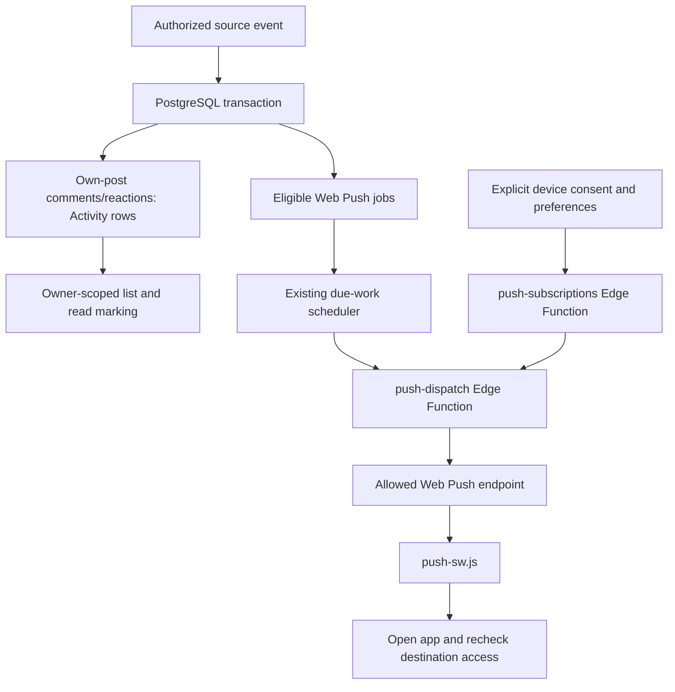

# Architecture

This describes the local vanilla-JavaScript refactor for **BETA v0.1.1.1**, prepared locally.
Production is recorded at main `34b4766`; the refactor branch has not been
published. Existing behavior, backend contracts and PWA identity are preserved.
See [deployment status](../DEPLOY.md) for dated evidence.

## Entry points and module ownership

`index.html` loads public `config.js`, then ES module `app.js`. The coordinator
selects the demo or cloud adapter from configuration. Supabase client creation
stays in `app.js`; importing an adapter does not create a client or start a session.

| File | Responsibility | Retained boundary |
| --- | --- | --- |
| [app.js](../app.js) | State, rendering/actions, routing, account/request guards, camera streams, dialogs and photo caches | Stateful lifecycle and async UI continuations stay centralized |
| [src/presentation.js](../src/presentation.js) | Escaping, date/initial formatting and stateless markup | No user state or DOM lifecycle |
| [src/auth-helpers.js](../src/auth-helpers.js) | Session-error classification and caller-injected recovery storage | No Auth clients, subscriptions or routing |
| [src/image-processing.js](../src/image-processing.js) | Canvas JPEG encoding and bitmap/Image decoding in the browser realm | Callers own capture state, avatar crop/upload and bitmap disposal |
| [src/cloud.js](../src/cloud.js) | `createCloud()` over caller-owned Supabase clients | Per-factory account generations, locks and cleanup journals remain together |
| [src/demo.js](../src/demo.js) | Local synthetic adapter and sample data | Existing `azice-demo-v1` storage format and factory behavior |
| [cloud.js](../cloud.js), [demo.js](../demo.js) | Compatibility re-exports | Existing root URLs and public exports remain available |
| [styles.css](../styles.css) | Complete presentation cascade | One file, with intentional rule/declaration/media order |

Root and `src/` imports share adapter function identity. Each explicit factory
call still owns its own closures; there is no new global adapter singleton. Demo
and cloud method surfaces intentionally differ for backend-only capabilities.

## Demo and configuration boundary

Fresh clones have empty source configuration. The local server serves demo config
unless ignored `config.local.json` supplies an approved disposable project's public
settings. Validation rejects the production URL in local overrides and privileged
Supabase key roles. [Contributor setup](../CONTRIBUTING.md).

Demo data stays in this browser's localStorage; bundled illustrations are not user
photos. The demo does not implement real Auth, friend delivery or Web Push, and
does not reproduce backend authorization/failure behavior.

`config.production.json` contains existing **public** browser settings, not a
service credential or secrecy boundary. Netlify production reads that profile;
default, branch and PR-preview builds use demo configuration. Do not open a
production-configured build as a contributor sandbox. Untrusted-build permissions
still need a separate hosted review regardless of local defaults.

## Auth and async ownership

The app owns a normal Auth client and an isolated recovery client. Recovery session
entries remain tab-local; only existing PKCE verifier keys are shared through
injected storage. App routing guards prevent ordinary auth-state changes from
abandoning active recovery. [Password recovery](backend/password-recovery.md).

Account generations and request versions guard late Profile, Feed, avatar and
comment continuations. Returning to Feed refreshes server-authorized content;
failed refreshes must not silently substitute stale private data. Comment forms
guard pending submissions without content-based deduplication. These guards
prevent UI races; they do **not** replace server authorization.

## PostgreSQL and private media

The cloud adapter uses the signed-in client's queries, RPCs and official Storage
API. PostgreSQL constraints, RLS and narrowly authorized RPCs remain authoritative
for friendships, visibility, profile privacy, interactions and posting quotas.
The Feed uses the existing 48-hour window; authorized history/single-post access
has separate limits, with old interactions read-only. There is no public profile
directory. [Friendship permissions](backend/friendship-helper-security.md).

Posts start as drafts with photo metadata/reservations, upload to private paths
and publish through the existing RPC. Failed/uncertain operations retain recovery
information. The per-account journal and operation locks stay inside `createCloud()`;
moving the module changes no keys or ownership. [Upload recovery](backend/post-upload-recovery.md)
and [daily cap](backend/daily-posting-cap.md).

Post photos resize proportionally to a 1600px longest edge without upscaling, then
encode as JPEG at existing 0.80 quality. Stored post photos keep their proportions;
4:5 cropping is presentation only. Avatar square processing stays in its existing
UI flow. Authenticated downloads become temporary object URLs with bounded reuse
and cleanup, not public photo URLs or worker private-image caches.
[Photo acceptance checks](testing/photos.md).

Account deletion invokes the existing `delete-account` Edge Function; its normal
sequence uses Storage APIs before Auth deletion. **R03 remains unresolved**: this
is not a concurrent-erasure guarantee, and physical leakage is unconfirmed. No new
reproduction details or investigation are introduced here. [Security policy](../SECURITY.md).

## Activity and notifications

- **Friend requests:** the header indicator/toast reuse account-scoped data and
  refresh/focus/visibility hooks. They are separate from OS push, not proof of
  continuous realtime delivery.
- **Activity:** server-generated comments and initial reactions from others on
  your posts are independent of push consent. The latest 50 eligible entries and
  unread state use the same bounded set, with 30-day retention and owner-scoped
  marking. [Activity](backend/activity.md).
- **Web Push:** explicit action starts permission/subscription registration.
  Per-device consent, preferences, grouping, quotas and current eligibility are
  server checked. Reminders remain optional/off by default. Payloads omit private
  photos, reasons and comment bodies; generic lock-screen text and authorized
  destination resolution are separate steps. [Web Push](backend/web-push.md).
- **Server boundary:** private VAPID/dispatcher/service credentials remain
  server-side. Existing Edge Functions are `delete-account`, `push-subscriptions`
  and `push-dispatch`; no function, secret or schedule changes with this refactor.

## Build, hosting and PWA cache

The explicit build allowlist copies root compatibility modules and approved `src/`
runtime modules into `dist/`. It excludes docs/screenshots, tests, SQL, Edge source,
local configuration and authoring assets. Netlify runs `node scripts/build.mjs`
and publishes **dist**, not the repository root. There is no frontend bundler.
[Deployment contract](../DEPLOY.md).

`sw.js` precaches the public shell, including both adapter URLs, in a versioned
cache. Same-origin shell requests retain network-first fallback; config deliberately
bypasses worker fetch interception. Private Supabase requests/photos are not
shell-cached. `push-sw.js` is imported by the registered worker, with notification
handlers separate from shell fetch handling. Manifest identity and `/sw.js` stay stable.

Compatibility shims and implementations must ship together. Tests model evaluated
old clients, cached bootstrap, updates, rollback and incomplete installation. They
do not implement a real worker controller, eviction, every in-flight release race
or live authenticated offline use.

## Test boundaries

Native ESM fixtures link the real graph and test exports, function identity,
browser realms and singleton initialization/listeners. Synchronous legacy tests
use a test-only same-realm image bridge, with independent ESM/browser checks.
Packaging follows reachable modules and checks local JavaScript MIME types.
CSS tests preserve the full pre-format ordered inventory. PGlite runs SQL/RLS in
disposable memory; native PostgreSQL, Deno, Storage and devices are separate evidence.

See [verification limits](testing/verification-limits.md),
[module gates](../tests/MODULE_TESTING.md) and the [documentation index](README.md).
Archives retain checkpoint-specific paths/counts, not current deployment commands.
